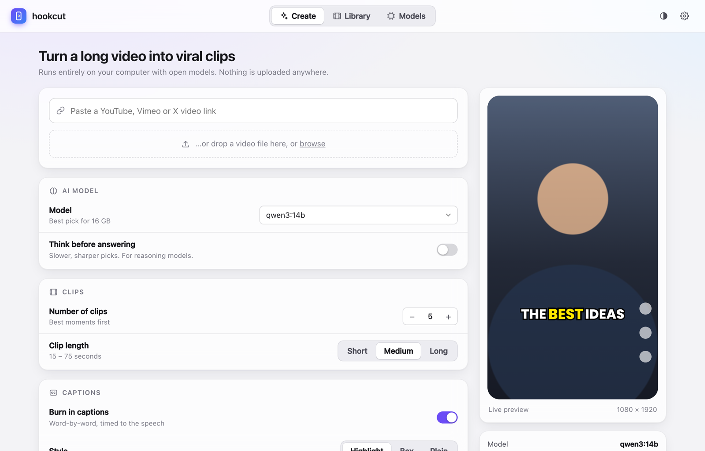
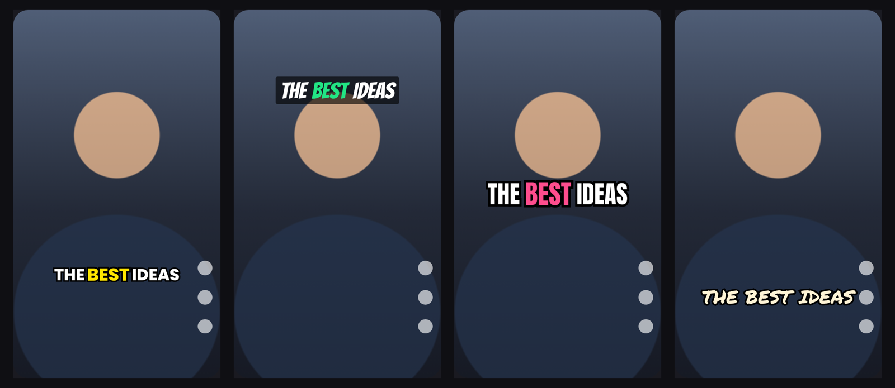
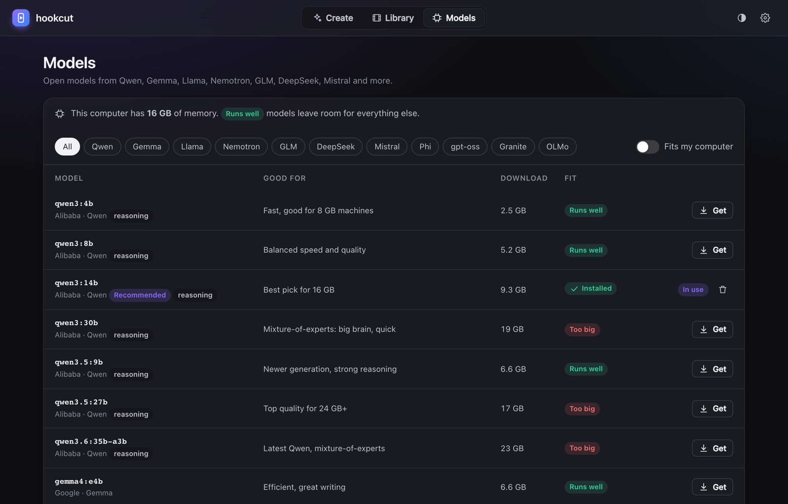

<div align="center">

# ✂️ hookcut

### Turn long videos into viral Shorts, Reels & TikToks. 100% on your own computer.

**Free and open source. No cloud, no API keys, no subscription, no watermark, no upload limits.**

Paste a YouTube link or drop in a video. A local AI watches for the moments worth
posting, cuts them to 9:16, keeps the speaker in frame, and burns in animated captions.

[](LICENSE)
[](https://www.python.org)
[](#-install)
[](#-why-hookcut)
[](https://github.com/abhay-error/hookcut/actions/workflows/ci.yml)

<picture>
  <source media="(prefers-color-scheme: dark)" srcset="docs/images/hero-dark.png">
  
</picture>

[**Quick start**](#-quick-start) · [**Features**](#-features) · [**Models**](#-pick-a-model) · [**How it works**](#-how-it-works) · [**Roadmap**](#%EF%B8%8F-roadmap) · [**Contributing**](#-contributing)

</div>

---

## 💡 Why hookcut?

AI clipping tools are great, but the popular ones are paid cloud services. You upload
your footage to someone else's servers and pay every month, often by the minute of
video. hookcut does the same job **on the machine you already own**.

| | Typical cloud clipper | **hookcut** |
|---|---|---|
| Price | Monthly subscription / credits | **Free forever** (MIT) |
| Your video | Uploaded to their servers | **Never leaves your computer** |
| Video length & count | Capped by plan | **Unlimited** |
| Watermark | On free tiers | **Never** |
| AI model | Theirs, closed | **Your choice of 29 open models** |
| Works offline | No | **Yes** (after models are downloaded) |
| Hackable | No | **Yes**, it's Python. Change the prompt, add a style, ship a PR |

## ✨ Features

- **🧠 Finds the moments that hook.** A local LLM reads the transcript and scores every
  candidate against a viral-clip rubric: hook in the first line, makes sense without
  context, real payoff, no rambling. You get a score and a reason for every clip.
- **🎯 Speaker stays in frame.** Detects camera cuts and centres each shot on the main
  face, using one steady crop per shot like a human editor (no jittery auto-pan).
- **💬 Captions people actually watch.** Word-by-word highlight, box, or plain styles,
  **13 fonts**, any size, any position, custom colours, with a **live preview**.
- **🤖 29 open models, one click.** Qwen, Gemma, Llama, Nemotron, GLM, DeepSeek, Mistral,
  Phi, gpt-oss, Granite, OLMo. hookcut checks your RAM and tells you which ones run well.
- **⚡ Fast on any hardware.** Apple Silicon GPU (mlx-whisper), NVIDIA (CUDA/NVENC), or CPU.
- **📦 Ready to upload.** 1080×1920 H.264, loudness-normalised to −14 LUFS, sensible
  file sizes.
- **🖥️ App + CLI.** A clean local web app for Mac and Windows, plus a scriptable command line.
- **♻️ Smart re-runs.** Try another model or caption style on the same video and the
  download and transcript are reused.

<div align="center">

<br><sub>Same clip, four looks. Font, size, position, colours and style are all yours.</sub>
</div>

## 🚀 Quick start

```bash
# 1. Install a model runner and a model (one time)
#    → download Ollama from https://ollama.com, then:
ollama pull qwen3:14b

# 2. Install hookcut
pip install git+https://github.com/abhay-error/hookcut

# 3. Go
hookcut serve
```

Your browser opens the app. Paste a link and press **Generate clips**. That's it.

Prefer the terminal?

```bash
hookcut clip "https://www.youtube.com/watch?v=..." -n 5
```

## 📥 Install

You need **Python 3.10–3.12**, **[Ollama](https://ollama.com)** (or any OpenAI-compatible
local server), and **ffmpeg with libass** (for captions):

| OS | ffmpeg |
|---|---|
| macOS | `brew install ffmpeg-full` (the plain `ffmpeg` formula has no libass; hookcut finds `ffmpeg-full` automatically) |
| Windows | `winget install Gyan.FFmpeg` |
| Ubuntu / Debian | `sudo apt install ffmpeg` |

Then check everything with:

```bash
hookcut doctor
```

## 🤖 Pick a model

Download models from the **Models** tab (it shows what fits your machine), or with
`ollama pull`. Some good starting points:

| Your RAM | Try |
|---|---|
| 8 GB | `qwen3:4b` · `nemotron-3-nano:4b` · `llama3.2:3b` · `phi4-mini:3.8b` |
| 16 GB | **`qwen3:14b`** (default) · `gemma4:12b` · `deepseek-r1:14b` · `phi4:14b` · `glm4:9b` |
| 24 GB+ | `qwen3:30b` · `nemotron-3-nano:30b` · `gemma4:26b-a4b` · `gpt-oss:20b` · `mistral-small3.2:24b` |

<details>
<summary><b>See all 29 models in the app</b></summary>
<br>

</details>

Using **LM Studio, llama.cpp, vLLM or Jan** instead? Point hookcut at it:

```bash
hookcut config --set llm.backend=openai --set llm.base_url=http://localhost:1234/v1
```

## 🎨 Captions from the command line

```bash
hookcut clip talk.mp4 --font bangers --size 110 --position top --style box
hookcut clip talk.mp4 --no-captions --centre      # raw clips, centre crop
hookcut fonts                                      # list fonts
hookcut models                                     # which models fit this computer
```

## 🔧 How it works

```
 long video ─► transcribe ─► find highlights ─► reframe 9:16 ─► captions ─► clips/01.mp4 …
              Whisper        local LLM picks      face tracking,   word-timed,
              (mlx / CUDA /  numbered sentences,  one steady crop  your font,
               CPU)          scores 0–100         per camera shot  size & position
```

1. **Transcribe** with Whisper (word-level timestamps), grouped into sentences.
2. **Find highlights:** the transcript is split into ~6-minute overlapping windows. The
   model sees **numbered sentences** and returns sentence ranges, never timestamps, so
   even a small model can't misplace a clip. Clips are fitted to your length limits,
   de-duplicated, and the top scorers win.
3. **Reframe:** frame-accurate cut detection, then MediaPipe face detection; each shot
   gets one crop centred on the speaker.
4. **Render** in a single ffmpeg pass: cut, crop, scale, burn captions, normalise audio.

The prompt lives in [`src/hookcut/stages/highlights.py`](src/hookcut/stages/highlights.py).
Better prompts are the easiest high-impact contribution you can make.

## 🗺️ Roadmap

- [ ] B-roll and emoji overlays
- [ ] Re-style captions on a finished clip without re-rendering everything
- [ ] Trim handles in the Library
- [ ] Multi-speaker framing (split screen for podcasts)
- [ ] One-click desktop installers (macOS `.dmg`, Windows `.exe`)
- [ ] Translated captions
- [ ] Benchmark of clip quality across models

Have an idea? [Open an issue](https://github.com/abhay-error/hookcut/issues). PRs are very welcome.

## ❓ FAQ

<details><summary><b>Is it really free? What's the catch?</b></summary>
No catch. It's MIT-licensed, and everything runs on your hardware. The only cost is your
electricity.</details>

<details><summary><b>How fast is it?</b></summary>
On an M1 Pro with 16 GB, a 3-minute excerpt went from file to two finished, captioned
clips in about 70 seconds with <code>qwen3:14b</code>. Longer videos scale roughly with
length; picking a smaller model is faster.</details>

<details><summary><b>Do I need a GPU?</b></summary>
No. A GPU (Apple Silicon or NVIDIA) makes transcription and the LLM much faster, but
everything works on CPU.</details>

<details><summary><b>Which languages work?</b></summary>
Whisper transcribes 90+ languages, and most of the listed models are multilingual.
Set the language in Settings or leave it on auto-detect.</details>

<details><summary><b>YouTube says "Sign in to confirm you're not a bot"</b></summary>
In Settings, set <b>YouTube cookies</b> to the browser you're signed in with, close that
browser, and try again. Or download the video yourself and drop the file in.</details>

## 🤝 Contributing

```bash
git clone https://github.com/abhay-error/hookcut && cd hookcut
python -m venv .venv && .venv/bin/pip install -e ".[dev]"
.venv/bin/pytest        # runs in seconds, no models needed
```

The tests render real video with ffmpeg but stub out Whisper and the LLM. See
[CONTRIBUTING.md](CONTRIBUTING.md) for the project layout and good first issues.

## ⚖️ Use responsibly

Only clip videos you own or have permission to use, and respect creators' rights and
each platform's terms.

## 🙏 Credits

Inspired by [AutoClip](https://github.com/artbyjazi/autoclip). Built on
[Whisper](https://github.com/openai/whisper),
[faster-whisper](https://github.com/SYSTRAN/faster-whisper),
[mlx-whisper](https://github.com/ml-explore/mlx-examples),
[MediaPipe](https://github.com/google-ai-edge/mediapipe),
[yt-dlp](https://github.com/yt-dlp/yt-dlp), [FFmpeg](https://ffmpeg.org),
[Ollama](https://ollama.com) and fonts from [Google Fonts](https://fonts.google.com).

<div align="center">
<br>

**If hookcut saved you a subscription, a ⭐ helps other creators find it.**

[](https://star-history.com/#abhay-error/hookcut&Date)

MIT © abhay-error and hookcut contributors

</div>
